In this article, we will be looking at how we control Tuya Devices Locally using Local Tuya.

  
<TOCInline toc={props.toc} asDisclosure />

## Pre-Requisites

1.  You have **Home Assistant OS** or **Home Assistant Container** setup.

You can check [this](https://smarthomecircle.com/connect-wifi-on-home-assistant-on-startup) article if you setting up Home Assistant OS for the first time or [this](https://smarthomecircle.com/run-home-assistant-container-with-docker) article if you want to set up Home Assistant Container.

2. You have HACS Installed.

If you have not installed it, here is a step-by-step guide to install it on Home Assistant OS and Home Assistant Docker container.

3. Any Tuya device. In this case, we will be using the Tuya Wifi Plug.

You can buy it from this link:

-   [Tuya Wifi Plug](https://link.amazon/B0dxMGN2F)
[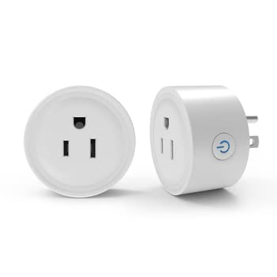](https://link.amazon/B0dxMGN2F)

4. Tuya device setup with either Tuya app or Smart Life app.

## Installing Local Tuya Integration in Home Assistant

Once you have HACS installed, head over to the HACs interface, click on “Explore and Download Repository” and search for Local Tuya Integration.

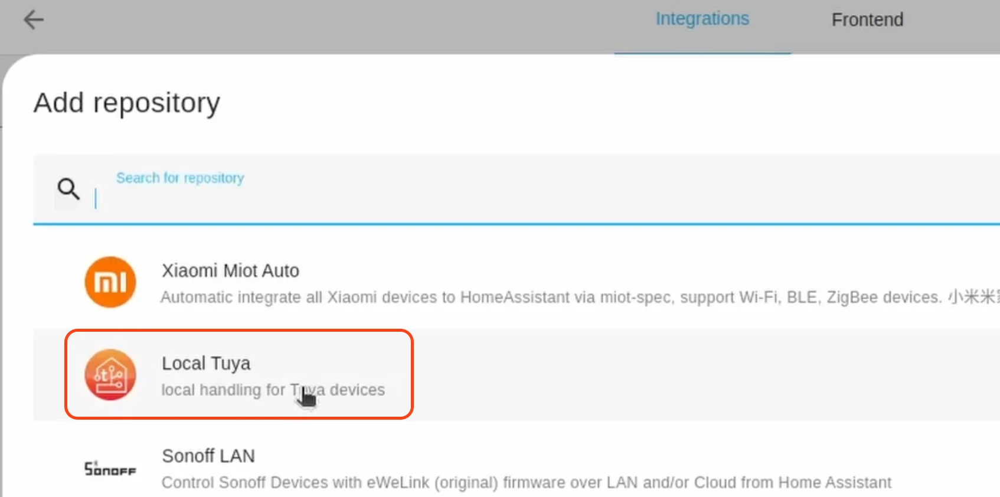

Once you find it, click on it and

Next, in Home Assistant UI, click on “Settings” in the left panel and then click on “Devices & Services”, then click on “Add integration” on the bottom right-hand corner.

Next, search for “Zigbee Home Automation” and click on the “Download” button, select the latest version, and click “Ok”.

Once the repository gets downloaded you will have add the integration.

For this, go to “Settings” then “Devices & Services”, click on “Add Integration” and search for Local Tuya.

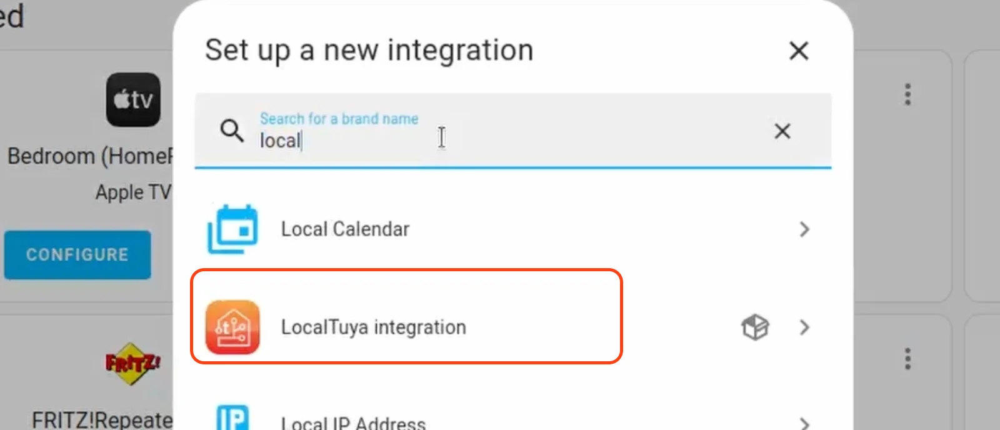

Now, it will ask you for a Cloud API integration.

Since we are not going to integrate with the cloud, click the checkbox a the bottom “Do not configure Cloud API Account”

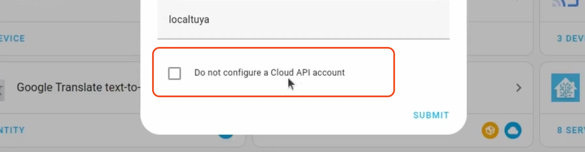

With this, the Local Tuya Integration is ready for use.

## Adding Device To Home Assistant using Local Tuya

Now, let’s consider you have your Tuya device connected to your Wifi network using the Smart Life app.

Next, make sure to connect the plug to a power outlet and then connect some device to it such that it's consuming some energy. (It could be your phone charger actively charging your mobile phone).

We would be using the values of the energy consumption that shows up in the Smart Life app to properly configure the plug in Local Tuya.

With this done we will search for this plug which is connected to your Wifi network using the Local Tuya integration.

For this, we will open the Local Tuya Integration and click on “Configure” and then select the action “Add a new Device”.

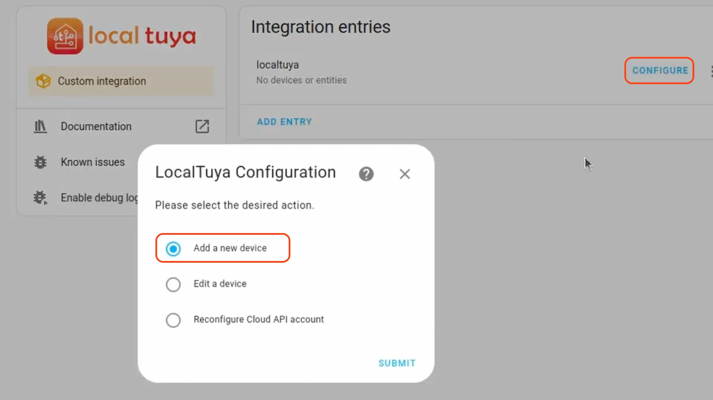

Now, it will show you the device id of your Tuya device.

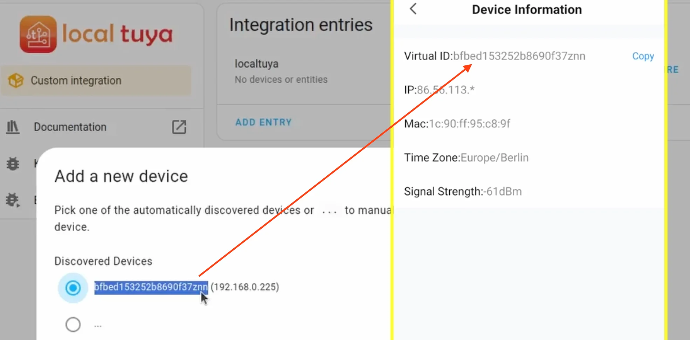

You can verify the device id of your device by checking the “device information” in the Smart Life app as shown above.

Next, we will have to fill in the local key.

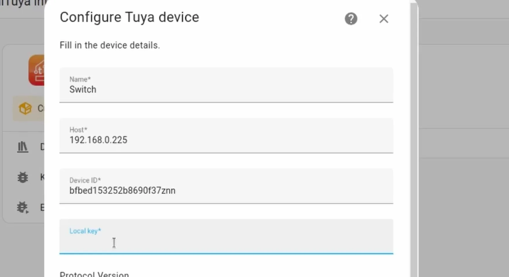

For this, we will have to create a Tuya developer account to find the Local key.

## Finding Local Key For Tuya Devices

To find the Local key, you will have to create a Tuya developer account.

We will only need this account to find the Local Key and then we can delete the account.

For this, head to [https://iot.tuya.com/](https://iot.tuya.com/) and create a developer account.

Once you have logged in, click on the “Cloud” icon on the left menu bar and then click on “Create Cloud Project”

Here, specify any project name, any industry, any development method, and then any data center that you wish.

Remember we won’t be needing this project after we find the Local keys.

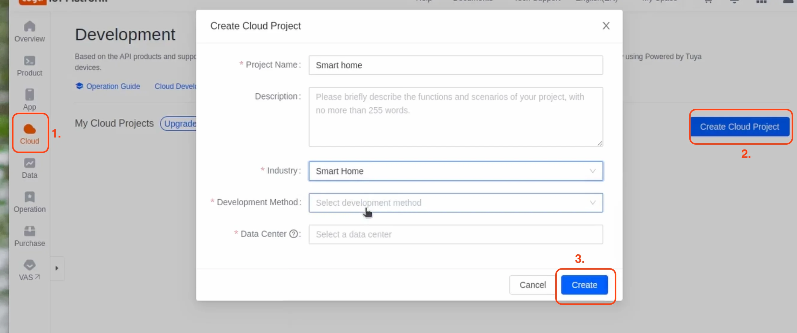

Once the project is created, click on the “Devices” tab and then click on “Link Tuya app”.

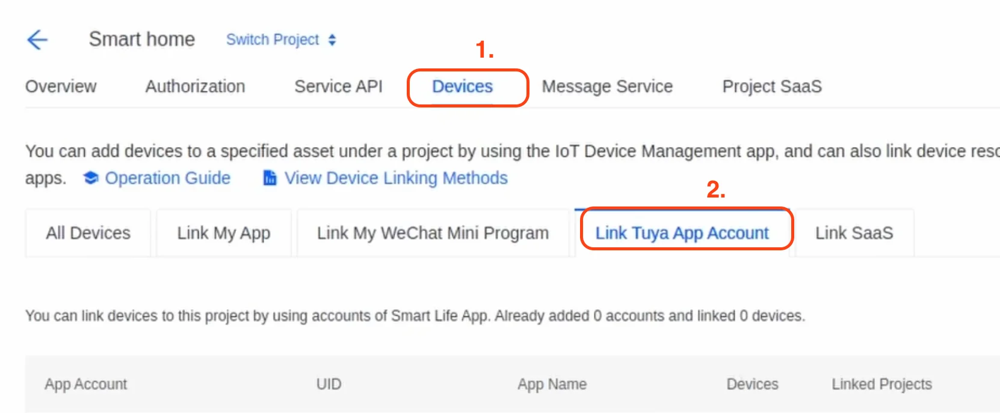

Now, scan the QR code using your Smart Life app, by selecting the add device option in the app and scan the QR code.

With this, the app is now linked to the cloud project.

Next, click on “Cloud” on the left panel and select “API Explorer”

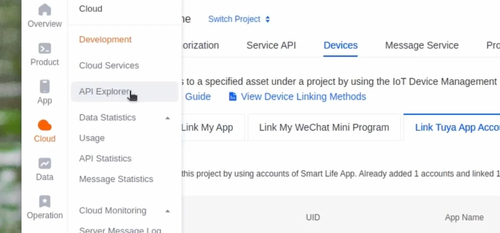

This will open in a new tab.

Now, in this new tab, click on “Device Management” in the left panel and then click on “Query Device Details”, enter the device id of your tuya device, and click on “Submit Request”

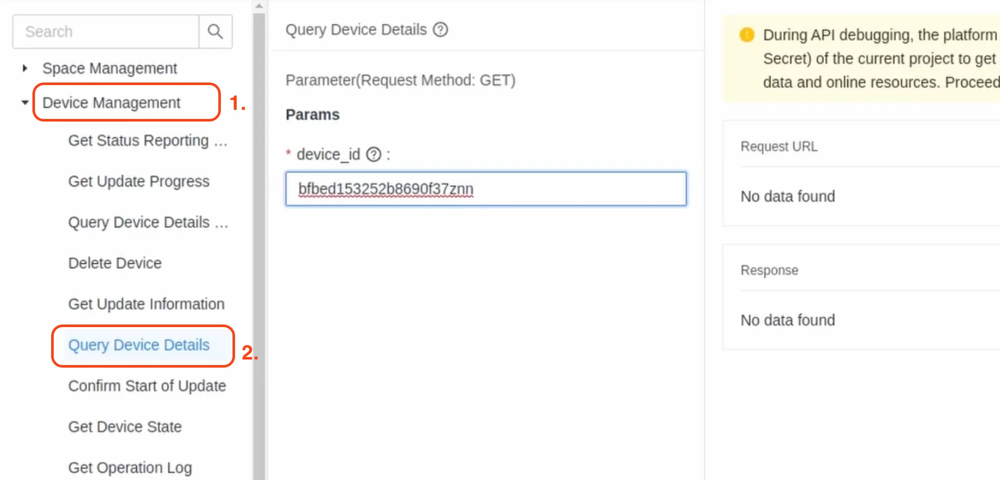

This will show a response. You need to now use the Local Key in the response as shown below.

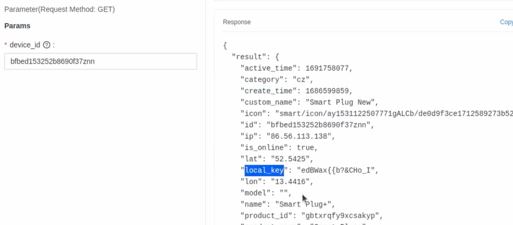

  

## Adding Local Key to Local Tuya Device

Once you have figured out the Local Key, add it to the Local Tuya setup.

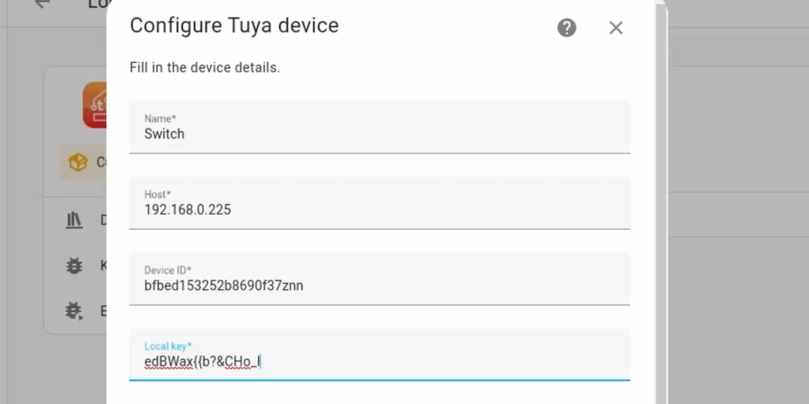

Now click next and here we will configure the Consumption value.

For this, open the power consumption section in the Smart Life app and check the current consumption values.

You will have to select the values that are close to the values in the drop. You can ignore the decimal points, but if the numbers match you can probably use the value.

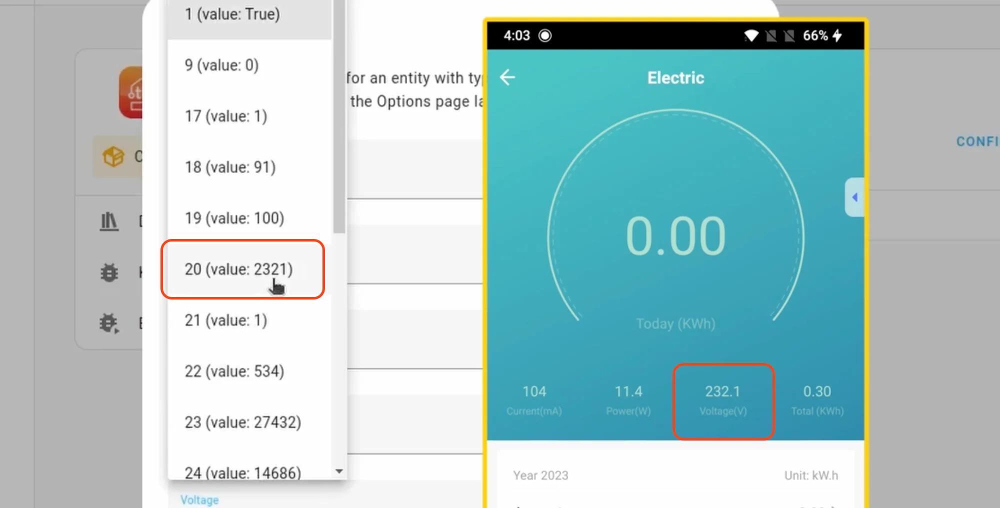

For example, in the above image, the voltage value even though it shows, 232.1, you can select the number 2321.

Same thing you would have to do for the current and current consumption values.

Once you do that click on finish.

You should be able to see the plug now in Home Assistant.

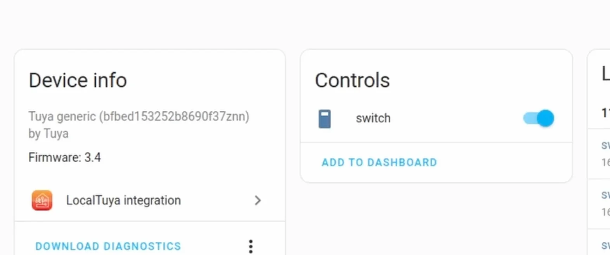

## Verify Energy Consumption Values

To verify the energy consumption values are correct, click on the “Developer Tools” in Home Assistant and select the “States” tab.

Now here filter the entities by the switch entity name you gave.

Now in the fouth column compare the values with the Smart Life app.

If they match, it's all good.

But if they are not correct and don’t match that on the app, you will have to reconfigure the values.

For this, you can head over to the Local Tuya Integration again, Click on “Configure” then this time select “Edit a device”

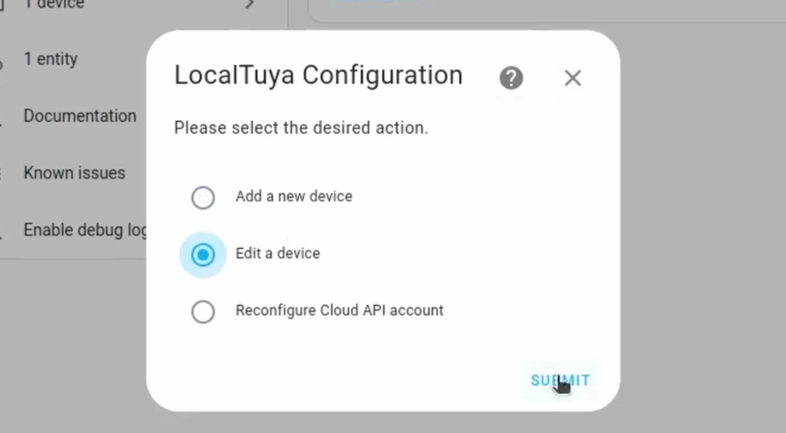

Now, when you create the energy consumption value section, you will just have to try with a different value and see if it works.

Its a bit difficult to get it correct in the first go, so you might have to keep trying different values for sometime. 🙂

Once you find the correct values, it should be all fine.

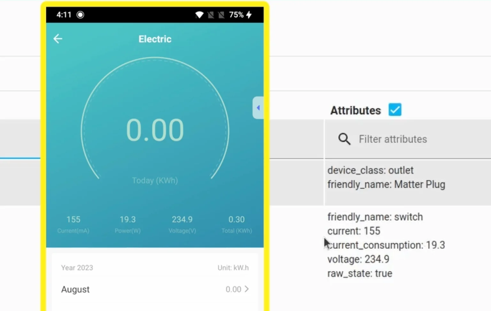

  

If you are interested in more such Home Automation Setups and Ideas, you can read the following three articles

-   [**Setup ESP32 CAM With ESP Home and Home Assistant**](https://smarthomecircle.com/esp32-cam-esphome-with-home-assistant)
-   [**Adding a Matter Device to Home Assistant**](https://smarthomecircle.com/add-matter-devices-to-home-assistant)
-   [**Build Air Quality Monitor With Light Sensor For Home Assistant**](https://smarthomecircle.com/air-quality-sensor-and-light-sensor-esp32-home-assistant)